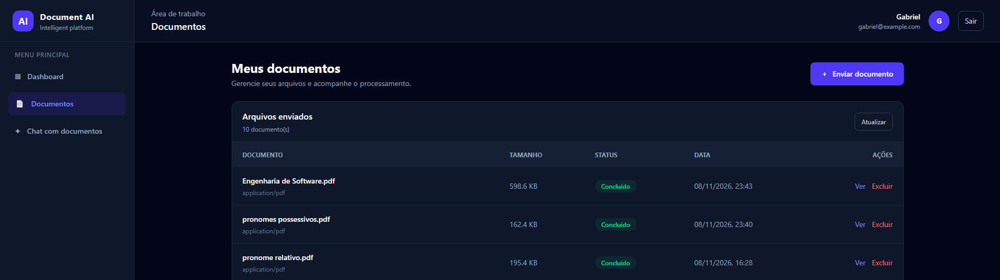
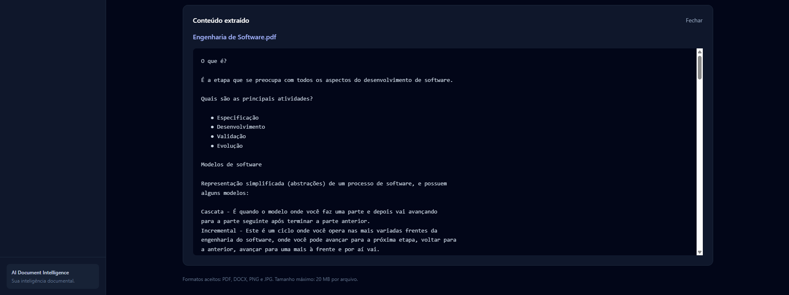
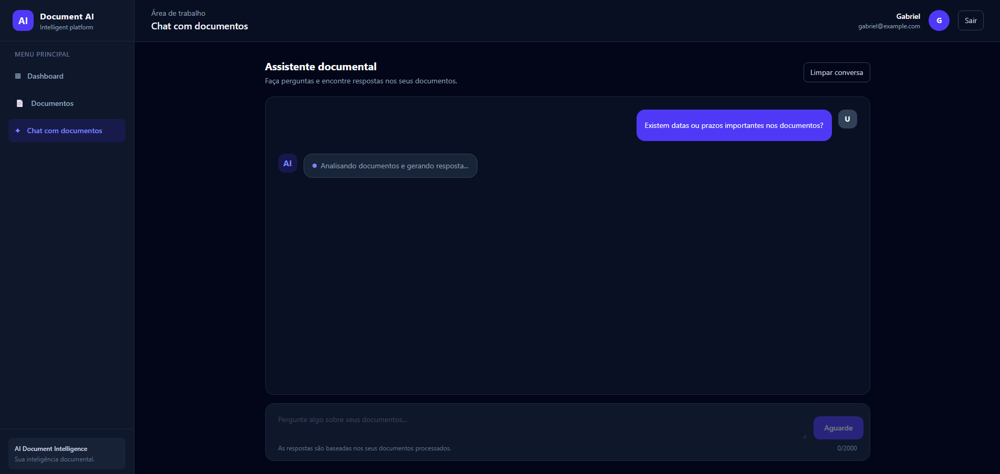

# AI Document Intelligence

Plataforma de inteligência documental em desenvolvimento com Laravel e ferramentas de inteligência artificial, com o objetivo de permitir o envio, processamento, extração, indexação e consulta inteligente de documentos.

O sistema utiliza tecnologias gratuitas e open source, priorizando processamento local, organização dos dados, busca semântica e geração de respostas fundamentadas no conteúdo dos documentos.

### Estado atual do desenvolvimento

O projeto está em desenvolvimento incremental,estou focando na confiabilidade da extração textual, preservação da estrutura documental e qualidade da recuperação semântica.

O serviço de normalização textual já possui testes unitários e validação com documentos reais, mas ainda não está integrado ao fluxo principal de processamento.

A arquitetura está sendo preparada para permitir futuras evoluções, incluindo melhorias na interpretação documental, recuperação contextual e disponibilização de funcionalidades como serviço (SaaS).

## Como está ficando até o momento

<h4>Página principal onde você pode fazer o upload de seus arquivos para a extração.</h4>

<h4>Resultado da extração do documento.</h4>

## Inteligência Artificial que está sendo desenvolvida (Parte 2 do projeto).

## Tecnologias utilizadas

### Backend e infraestrutura

- **PHP 8.5** – Linguagem principal do backend.
- **Laravel 13** – Framework utilizado para desenvolvimento da aplicação.
- **Laravel Sail** – Ambiente de desenvolvimento baseado em Docker.
- **Docker** – Containerização dos serviços.
- **MySQL** – Banco de dados relacional para armazenamento das informações.
- **Redis** – Gerenciamento de filas e processamento assíncrono.
- **Laravel Sanctum** – Autenticação e proteção dos endpoints da API.
- **Meilisearch** – Motor de busca textual e indexação.

### Processamento e extração de documentos

- **Tesseract OCR 5.3** – Reconhecimento óptico de caracteres (OCR) para extração de texto de documentos digitalizados e imagens.
- **Poppler** – Ferramentas para manipulação e processamento de arquivos PDF.
- **pdftotext** – Extração de texto nativo de arquivos PDF, preservando o layout sempre que possível.
- **pdftoppm** – Conversão de páginas PDF em imagens para processamento via OCR.
- **DocxTextExtractor** – Serviço próprio para extração de conteúdo de documentos DOCX, utilizando a estrutura XML interna do formato.

O processamento de PDF utiliza uma abordagem híbrida: cada página é analisada individualmente, priorizando a extração nativa de texto e recorrendo ao OCR quando necessário. Isso permite trabalhar com documentos digitais, digitalizados e mistos.

### Inteligência artificial e processamento semântico

- **Ollama** – Execução local de modelos de linguagem.
- **Qwen** – Modelo de linguagem utilizado para geração de respostas.
- **BGE-M3** – Modelo de embeddings para representação vetorial do conteúdo textual.
- **Embeddings** – Transformação dos textos em vetores para comparação semântica.
- **Similaridade do cosseno (Cosine Similarity)** – Cálculo de proximidade entre vetores.
- **RAG (Retrieval-Augmented Generation)** – Arquitetura que combina recuperação de informações dos documentos com geração de respostas fundamentadas nas fontes recuperadas.

### Serviços e componentes desenvolvidos

O projeto possui serviços próprios responsáveis por diferentes etapas do processamento:

- **TesseractOcrService:** extração de texto de PDFs, imagens e documentos digitalizados, incluindo processamento híbrido de PDFs.
- **DocxTextExtractor:** extração de conteúdo textual de arquivos DOCX.
- **TextNormalizer:** normalização textual com preservação de parágrafos, títulos, listas, tabelas e espaçamentos relevantes.
- **ChunkingService:** divisão dos documentos em blocos menores, com sobreposição entre chunks e preservação de seções.
- **CosineSimilarity:** cálculo da similaridade entre vetores.
- **OllamaGenerationService:** comunicação com o Ollama para geração de respostas.
- **RagService:** recuperação de informações relevantes e construção de respostas fundamentadas nos documentos.

### Funcionalidades implementadas

- Upload de documentos.
- Validação de formatos e tamanho dos arquivos.
- Autenticação de usuários.
- Controle de acesso aos documentos por usuário.
- Processamento assíncrono de documentos utilizando filas.
- Extração de texto de PDFs digitais.
- OCR de PDFs digitalizados.
- Processamento de PDFs mistos (texto nativo e páginas escaneadas).
- Extração de conteúdo de documentos DOCX.
- Divisão de documentos em chunks.
- Geração de embeddings em lotes.
- Indexação e busca semântica.
- Recuperação de trechos relevantes.
- Consulta aos documentos por meio de API.
- Geração de respostas utilizando RAG.
- Referências e citações dos trechos utilizados nas respostas.
- Validação das citações para evitar respostas factuais sem fundamentação.
- Isolamento dos documentos entre usuários.

### Testes automatizados

O projeto utiliza o **PHPUnit**, integrado ao sistema de testes do Laravel.

Os testes cobrem:

- Extração de texto e OCR.
- Processamento de PDFs digitais, digitalizados e mistos.
- Extração de documentos DOCX.
- Normalização textual.
- Divisão e organização de chunks.
- Similaridade vetorial.
- Geração de respostas com Ollama.
- Recuperação de informações com RAG.
- Busca semântica.
- Autenticação e autorização.
- Upload, processamento e exclusão de documentos.
- Isolamento de dados entre usuários.

**Última validação geral:** 114 testes aprovados e 386 assertions, sem falhas.

## Objetivo do projeto

Construir uma plataforma capaz de transformar documentos em uma base de conhecimento consultável, permitindo que usuários façam perguntas em linguagem natural e recebam respostas contextualizadas, acompanhadas de referências aos documentos utilizados.
